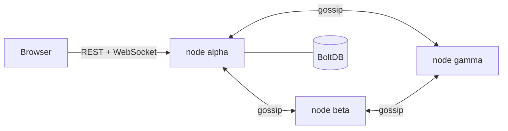

# ⛓ Chainforge

**A blockchain written from scratch in Go that you can break live.**
Proof of Work, signed transactions, Merkle trees, a P2P network with fork resolution, and a cyberpunk web UI.

🔗 **Live demo:** https://YOUR-DOMAIN


## What you can do on the live site
- **Watch** blocks get mined in real time over WebSockets
- **Tamper Lab:** edit a block and watch every block after it turn red, then re-mine to see what rewriting history costs
- **Network:** 3 independent nodes gossip blocks to each other. Stop one and the others keep going
- **Wallet:** keys are generated in your browser, transactions are signed client-side (ECDSA P-256) and verified by the node
- **Explorer:** search blocks, transactions and addresses. Every block hash is re-verified in your browser

## How it works


| Piece | Details |
|---|---|
| Blocks | Header = index, timestamp, prev hash, Merkle root, difficulty, nonce. SHA-256 |
| Consensus | Proof of Work (leading hex zeros). Longest valid chain wins; nodes reorg automatically |
| Transactions | ECDSA P-256 signatures, address = SHA-256(pubkey)[:40], replay and double-spend protection |
| Validation | Every node re-verifies PoW, Merkle root, signatures and balances for every block it receives |
| Persistence | BoltDB; the whole chain is re-validated on boot |
| Networking | HTTP gossip, pull-based sync, fork detection, shared-key auth between nodes |
| Frontend | React + TypeScript + Vite + Tailwind + shadcn/ui |

## Run it locally
```bash
# backend
go test ./...
go run ./cmd/node

# frontend (dev)
cd web && npm install && npm run dev      # http://localhost:5173
```
Three-node network: see `docker-compose.yml`, or run three `go run ./cmd/node` with different `-addr`, `-db`, `-wallet`, `-name`, `-public-url` and `-peers`.

## Deploy
```bash
cp .env.example .env   # set DOMAIN and PEER_KEY
docker compose up -d --build
```

## Security notes
Demo network: coins have no value. Public endpoints are rate limited per IP, request bodies are capped, and node-to-node routes require a shared key and are not exposed publicly. Keys in the browser wallet are stored unencrypted in localStorage.

## Roadmap
Proof of Stake mode · Merkle proofs in the explorer · WebAssembly smart contracts
